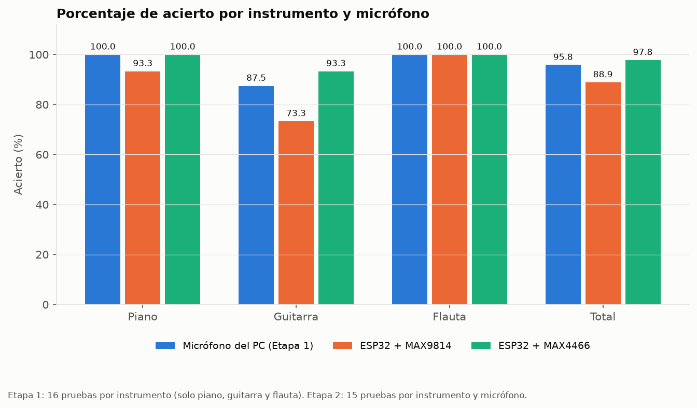
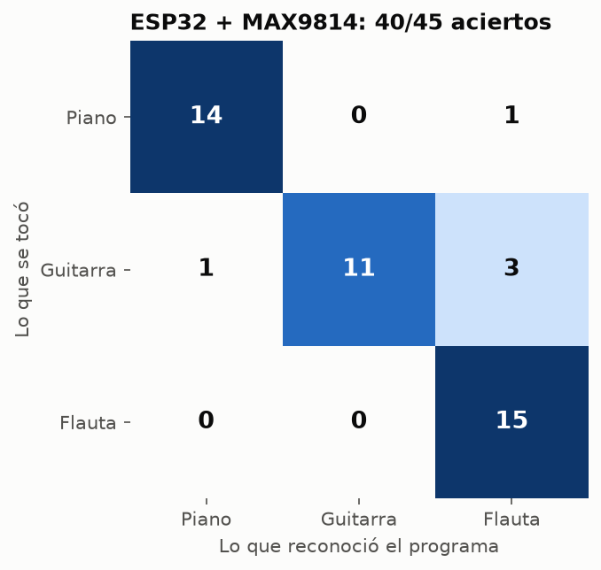
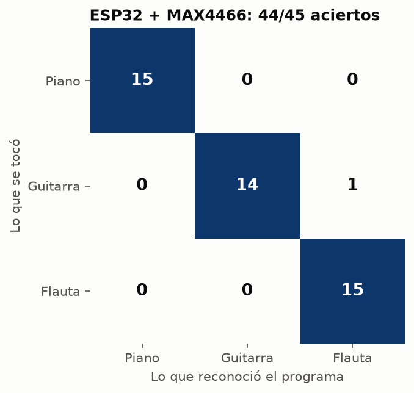
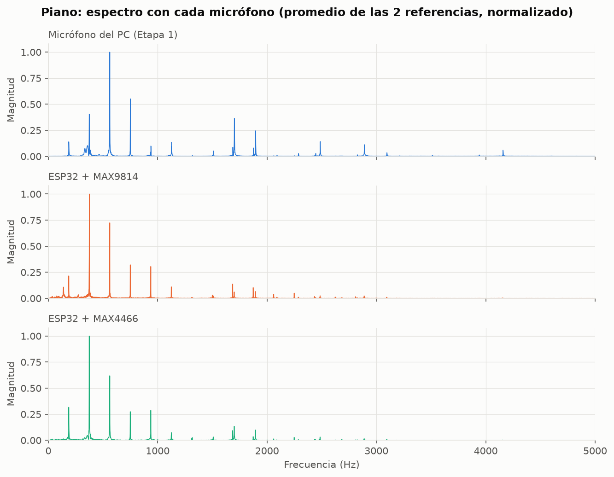
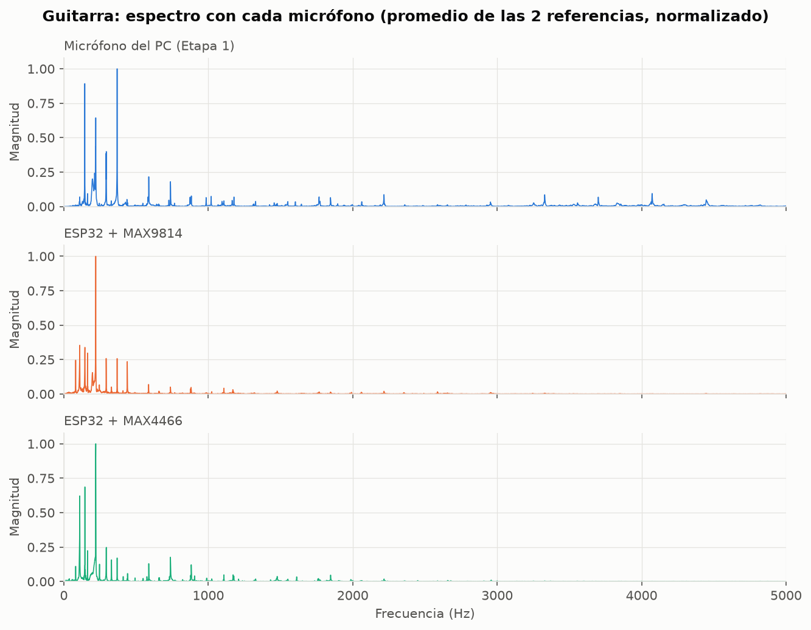
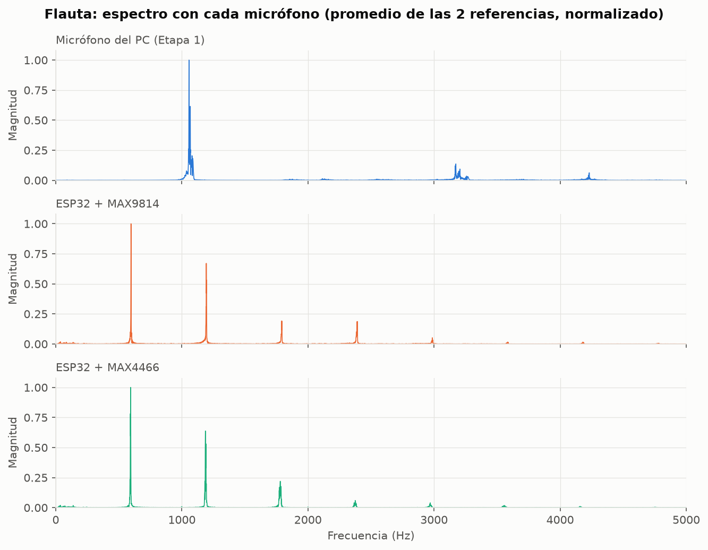

# Reconocimiento de instrumentos con análisis espectral

Trabajo del curso de Teoría de Señales. Es un programa en Python que escucha una nota por el micrófono del computador y dice si suena a piano, guitarra, flauta o voz. Para decidirlo mira el espectro del sonido (la FFT): cada instrumento reparte su energía de forma distinta entre la frecuencia fundamental y los armónicos, y esa forma es lo que se compara.

El proyecto tiene dos etapas:

- **Etapa 1:** se graba con el micrófono del PC. Está terminada (resultados abajo).
- **Etapa 2:** se graba con un ESP32 y dos micrófonos, MAX9814 y MAX4466, para comparar cuál reconoce mejor. El micrófono convierte el sonido en voltaje, el ESP32 mide ese voltaje 16 000 veces por segundo y manda los números al PC por USB. El análisis es el mismo de la Etapa 1. En esta etapa se usan 3 instrumentos: piano, guitarra y flauta.

## Cómo funciona

1. Se graba un fragmento de 2 segundos.
2. Se calcula la FFT y se sacan unas pocas características: frecuencia fundamental, energía de los primeros 6 armónicos y centroide espectral.
3. Esos números se comparan con un banco de referencia (el promedio de las grabaciones de cada instrumento) y gana el más cercano.

## Carpetas

```
proyecto_instrumentos/
├── codigo/
│   ├── grabar_audio.py
│   ├── analizar_espectro.py
│   ├── extraer_caracteristicas.py
│   ├── clasificador.py
│   ├── main_reconocimiento.py
│   ├── interfaz.py
│   ├── grabar_esp32.py       recibe el audio del ESP32 (Etapa 2)
│   ├── evaluar.py            hace las pruebas de acierto y arma la tabla
│   └── generar_graficas.py   genera todas las gráficas de la carpeta graficas/
├── esp32/                    programas que se cargan al ESP32 con el Arduino IDE
│   ├── prueba_microfono/
│   └── captura_audio/
├── referencias/              grabaciones de referencia con el micrófono del PC
├── referencias_max9814/      grabaciones de referencia con el MAX9814
├── referencias_max4466/      grabaciones de referencia con el MAX4466
├── resultados/               pruebas de acierto (CSV) y sus audios
├── graficas/
│   ├── pc/                   forma de onda y espectro de cada referencia de la Etapa 1
│   ├── max9814/              lo mismo con las referencias del MAX9814
│   ├── max4466/              lo mismo con las referencias del MAX4466
│   └── comparacion/          acierto por micrófono, matrices de confusión y espectros comparados
├── requirements.txt
└── README.md
```

## Instalación

Necesitas Python 3. Desde la carpeta del proyecto:

```powershell
python -m venv venv
.\venv\Scripts\Activate.ps1
pip install -r requirements.txt
```

En Windows 11, si al usar librosa aparece `ImportError: DLL load failed ... Una directiva de Control de aplicaciones bloqueó este archivo`, es Smart App Control bloqueando numba (lo usa librosa por dentro). Se desactiva en Seguridad de Windows → Control de aplicaciones y navegador → Configuración de Smart App Control, y se puede volver a activar al terminar.

## Uso

Todo se corre desde la carpeta raíz del proyecto.

Primero hay que grabar las referencias, dos por instrumento y siempre la misma nota (yo usé Re). La grabación empieza apenas presionas Enter, así que toca la nota justo ahí y déjala sonar.

```powershell
python codigo\grabar_audio.py referencias\piano_1.wav
python codigo\grabar_audio.py referencias\piano_2.wav
python codigo\grabar_audio.py referencias\guitarra_1.wav
python codigo\grabar_audio.py referencias\guitarra_2.wav
python codigo\grabar_audio.py referencias\flauta_1.wav
python codigo\grabar_audio.py referencias\flauta_2.wav
python codigo\grabar_audio.py referencias\voz_1.wav
python codigo\grabar_audio.py referencias\voz_2.wav
```

Si quieres ver cómo se ve el espectro de una grabación:

```powershell
python codigo\analizar_espectro.py referencias\piano_1.wav
```

Para reconocer un instrumento por la terminal:

```powershell
python codigo\main_reconocimiento.py
```

La primera vez arma el banco de referencia y lo guarda en `banco_referencia.json`. Si cambias o agregas grabaciones, borra ese archivo para que se recalcule.

### Interfaz

Hay una ventana sencilla, hecha con tkinter (viene con Python), que muestra el resultado en grande con un ícono en vez de dejarlo solo en la terminal:

```powershell
python codigo\interfaz.py
```

Presionas "Grabar y reconocer", tocas la nota y aparece el instrumento detectado. Usa el mismo banco y la misma lógica que `main_reconocimiento.py`.

## Etapa 2: ESP32 + MAX9814 + MAX4466

### Materiales

- ESP32 DevKit V1 de 30 pines (con su cable micro-USB, que debe ser de datos y no solo de carga).
- Módulo de micrófono MAX9814, con sus 5 pines soldados.
- Módulo de micrófono MAX4466, con sus 3 pines soldados.
- Una protoboard y cables jumper macho-macho.

### Especificaciones del muestreo

Están definidas al principio de `esp32/captura_audio/captura_audio.ino` (`FS`, `DURACION_MS`, `N`, `BAUDIOS`) y repetidas en `codigo/grabar_esp32.py` (`FS_OBJETIVO`, `BAUDIOS`).

| Parámetro | Valor |
|---|---|
| Frecuencia de muestreo | 16 000 Hz (una muestra cada 62,5 µs) |
| Frecuencia máxima que se puede ver (Nyquist) | 8 000 Hz |
| Duración de cada grabación | 2 s → 32 000 muestras |
| Resolución del ADC | 12 bits (valores de 0 a 4 095) |
| Tiempo medido por lectura del ADC | ≈ 40 µs, cabe en los 62,5 µs |
| Envío al PC | binario, 2 bytes por muestra, 921 600 baudios |

El ESP32 guarda primero las 32 000 muestras en su memoria (64 KB) y las manda al PC al terminar, para que el envío no interrumpa el muestreo. Cada muestra se toma en un instante calculado desde el inicio de la grabación, así el intervalo entre muestras queda parejo, que es lo que necesita la FFT.

### Conexión

Los dos micrófonos quedan conectados a la vez. La alimentación se reparte por las dos líneas largas del borde de la protoboard: + (marcada en rojo) y − (marcada en verde). En esta protoboard esas líneas están cortadas a la mitad, así que dos cables puente unen las dos mitades de cada una.

| Desde | Hasta |
|---|---|
| 3V3 del ESP32 | línea + |
| GND del ESP32 (el que está junto a 3V3) | línea − |
| MAX9814: Vdd y Gain | línea + (Gain a Vdd = ganancia de 40 dB) |
| MAX9814: GND | línea − |
| MAX9814: Out | D4 (GPIO4) |
| MAX9814: AR | sin conectar |
| MAX4466: VCC | línea + (siempre 3,3 V, nunca 5 V: con 5 V su salida podría dañar el pin del ESP32) |
| MAX4466: GND | línea − |
| MAX4466: OUT | D15 (GPIO15) |
| Puentes | uno en la línea + y otro en la − saltando el corte del medio |

D4 y D15 son entradas del ADC2 del ESP32, que solo falla cuando se usa el WiFi, y este proyecto no lo usa. Se usan porque son las únicas entradas analógicas del lado de 3V3, el único que deja huecos libres en la protoboard.

En silencio, la salida del MAX9814 queda en ~1,25 V (ADC ≈ 1 300–1 500) y la del MAX4466 en ~1,65 V (ADC ≈ 1 850). El MAX4466 tiene un tornillo de ganancia por detrás; se deja fijo durante todas las grabaciones.

**Importante:** el ESP32 y los micrófonos tienen que quedar metidos hasta el fondo de la protoboard, con el plástico negro de los pines tocándola. Si quedan apoyados encima, los pines no hacen contacto y todo marca 0 o un número bajo fijo.

### Cargar los programas al ESP32

Se usa el Arduino IDE 2 con el paquete "esp32 by Espressif Systems", la placa "ESP32 Dev Module" y el driver CP210x de Silicon Labs para el puerto USB. Si al subir se queda en "Connecting...", se mantiene presionado el botón BOOT.

1. `esp32/prueba_microfono`: para revisar un micrófono. Se cambia `PIN_MIC` (4 = MAX9814, 15 = MAX4466), se sube y se mira el Serial Monitor o el Serial Plotter a 115200.
2. `esp32/captura_audio`: el programa de verdad. Graba 2 s con el micrófono que pida Python y los manda al PC.

Antes de usar Python hay que cerrar el Monitor Serie y el Serial Plotter, porque ocupan el puerto.

### Grabar las referencias

Cada micrófono suena distinto, así que cada uno tiene sus propias grabaciones de referencia y su propio banco (`banco_max9814.json` y `banco_max4466.json`). Misma nota (Re), dos por instrumento:

```powershell
python codigo\grabar_esp32.py --micro max9814 referencias_max9814\piano_1.wav
python codigo\grabar_esp32.py --micro max9814 referencias_max9814\piano_2.wav
python codigo\grabar_esp32.py --micro max9814 referencias_max9814\guitarra_1.wav
python codigo\grabar_esp32.py --micro max9814 referencias_max9814\guitarra_2.wav
python codigo\grabar_esp32.py --micro max9814 referencias_max9814\flauta_1.wav
python codigo\grabar_esp32.py --micro max9814 referencias_max9814\flauta_2.wav
```

Para el MAX4466 son los mismos comandos con `--micro max4466` y la carpeta `referencias_max4466`.

Antes de grabar sale una cuenta regresiva (3, 2, 1, ¡YA!) y la grabación empieza justo en el ¡YA!, para que la nota ocupe los 2 segundos completos. El puerto del ESP32 se busca solo. Si no lo encuentra, `python codigo\grabar_esp32.py --listar` muestra los puertos y se le indica con `--puerto COM5`. Después de cada grabación el programa muestra el rango de voltaje que llegó y avisa si la señal se saturó o es muy débil. Si se cambian las referencias, hay que borrar el `banco_*.json` de ese micrófono para que se recalcule.

### Reconocer y evaluar

Para reconocer una nota suelta:

```powershell
python codigo\interfaz.py --fuente max9814
python codigo\interfaz.py --fuente max4466
```

Para las pruebas de acierto, `evaluar.py` dice qué instrumento tocar, graba cada prueba, anota si acertó y al final muestra la tabla y la matriz de confusión:

```powershell
python codigo\evaluar.py --fuente max9814 --pruebas 15
python codigo\evaluar.py --fuente max4466 --pruebas 15
python codigo\evaluar.py --fuente max9814 --resumen
```

Durante las pruebas: Enter graba, `d` descarta la última prueba y `q` sale. Todo queda guardado en `resultados/resultados_<fuente>.csv`, así que se puede seguir otro día con el mismo comando. El audio de cada prueba queda en `resultados/<fuente>/`.

Sin `--fuente`, todo funciona igual que en la Etapa 1 (micrófono del PC, 4 instrumentos).

## Resultados de la Etapa 1

Probé 16 veces cada instrumento, tocando la misma nota:

| Instrumento | Aciertos | Intentos | Acierto |
|---|---|---|---|
| Piano | 16 | 16 | 100 % |
| Guitarra | 14 | 16 | 87,5 % |
| Flauta | 16 | 16 | 100 % |
| Voz | 15 | 16 | 93,75 % |
| Total | 61 | 64 | 95,3 % |

Solo con piano, guitarra y flauta (los 3 instrumentos de la Etapa 2): 46 de 48, **95,8 %**.

## Resultados de la Etapa 2

15 pruebas por instrumento con cada micrófono, la misma nota de las referencias, con el banco de referencia propio de cada micrófono. Los datos de cada prueba (instrumento tocado, reconocido, f0 y centroide) están en `resultados/resultados_max9814.csv` y `resultados/resultados_max4466.csv`.

| Instrumento | Micrófono del PC (Etapa 1) | ESP32 + MAX9814 | ESP32 + MAX4466 |
|---|---|---|---|
| Piano | 16/16 (100 %) | 14/15 (93,3 %) | 15/15 (100 %) |
| Guitarra | 14/16 (87,5 %) | 11/15 (73,3 %) | 14/15 (93,3 %) |
| Flauta | 16/16 (100 %) | 15/15 (100 %) | 15/15 (100 %) |
| **Total** | **46/48 (95,8 %)** | **40/45 (88,9 %)** | **44/45 (97,8 %)** |



| MAX9814 | MAX4466 |
|---|---|
|  |  |

### Qué se observó

- El **MAX4466** fue el mejor de los tres (97,8 %), incluso un poco por encima del micrófono del PC. El **MAX9814** fue el más bajo (88,9 %).
- La **flauta** se reconoció siempre (100 % con las tres fuentes): su espectro es casi solo la fundamental, muy distinto a los otros dos.
- La **guitarra** es el instrumento más difícil con todas las fuentes. En 3 de los 4 fallos de guitarra del MAX9814, el estimador de f0 (pYIN) no encontró la fundamental real (73,4 Hz) y dio otro valor (89, 119 o 125 Hz); con la f0 equivocada, los armónicos se miden en frecuencias equivocadas y la guitarra termina pareciéndose a la flauta. En el cuarto la f0 fue correcta, pero sus armónicos quedaron más cerca del piano. El fallo del piano con el MAX9814 también fue por una f0 equivocada (70 Hz en vez de 187 Hz).
- El MAX9814 tiene control automático de ganancia (AGC): sube y baja la ganancia solo, lo que cambia la forma de la onda entre una grabación y otra. Es una explicación posible de por qué le fue peor, pero con 15 pruebas no alcanza para asegurarlo.
- En el MAX4466, la prueba `guitarra_14` tiene el espectro de la flauta (pico en 597 Hz y sonido sostenido), así que probablemente se grabó la flauta en esa prueba. Se dejó tal como quedó; sin ella, la guitarra con el MAX4466 sería 14/14.
- La flauta de la Etapa 2 se tocó en una nota distinta a la de la Etapa 1 (≈ 597 Hz contra ≈ 1 059 Hz). En cada etapa las referencias y las pruebas usan la misma nota, así que la comparación dentro de cada etapa es válida.

### Espectro del mismo instrumento con cada micrófono

Promedio de las dos referencias, normalizado al pico más alto. Los picos (armónicos) caen en las mismas frecuencias con los tres micrófonos; lo que cambia es la altura relativa de cada uno, que es justo lo que usa el clasificador.





### Gráficas de cada referencia

Cada grabación de referencia tiene su gráfica con la forma de onda y el espectro en `graficas/pc/`, `graficas/max9814/` y `graficas/max4466/`. Para volver a generarlas todas:

```powershell
python codigo\generar_graficas.py
```

Los audios de cada prueba (`resultados/<fuente>/*.wav`) se quedan en el computador y no se suben al repositorio; los resultados de cada uno están en los CSV.

## Limitaciones

- Funciona bien con la nota con la que se hizo el banco. Cuando canté otra nota, el programa la clasificó como piano.
- Son solo dos grabaciones de referencia por instrumento, así que el promedio es poco estable.
- Las pruebas se hicieron en un solo lugar y con un solo intérprete por instrumento.
- La f0 que da pYIN a veces sale en otra octava o en un valor equivocado, sobre todo con la guitarra, y eso causa la mayoría de los fallos.
- 15 pruebas por instrumento son pocas: una sola prueba cambia el resultado en 6,7 puntos.

Para mejorarlo habría que ampliar el banco con más notas y más grabaciones por instrumento.
