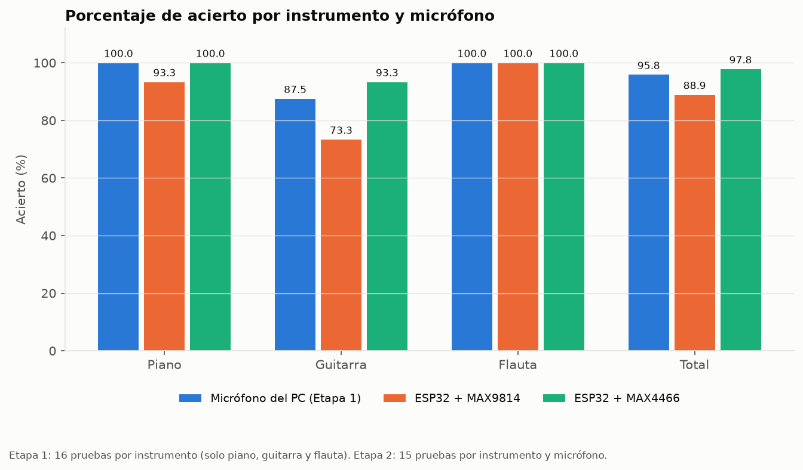
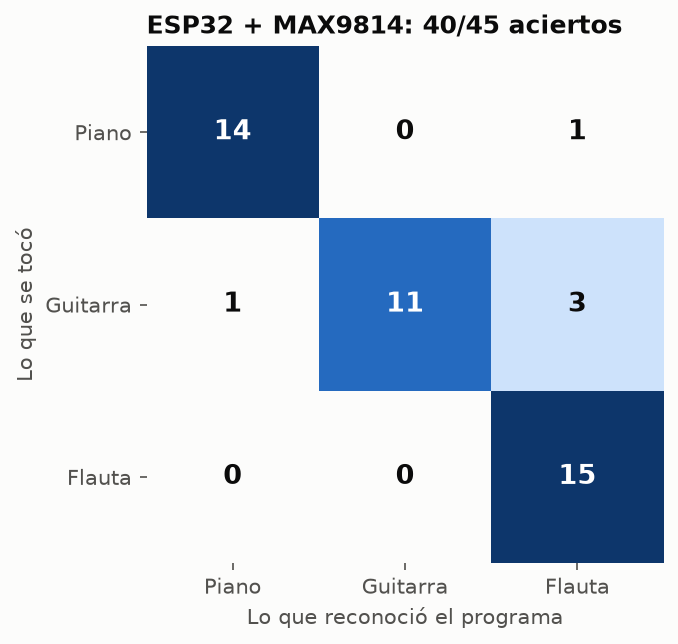
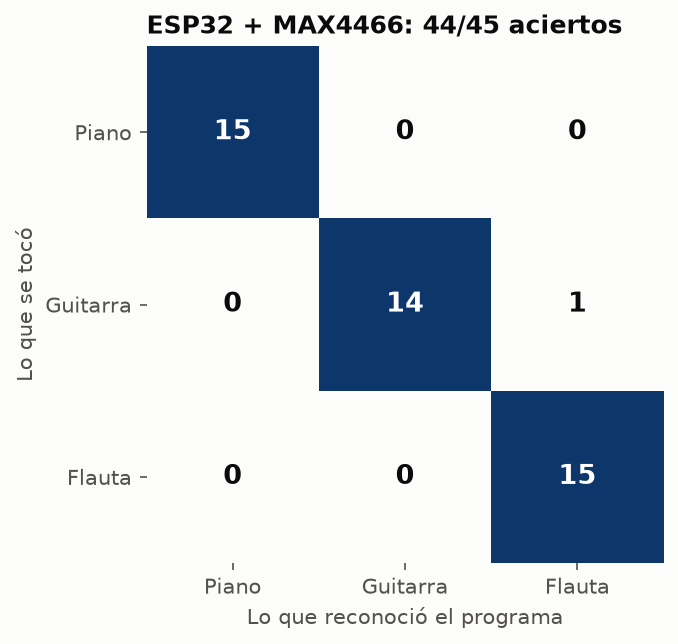

# Informe — Etapa 2: reconocimiento de instrumentos con ESP32, MAX9814 y MAX4466

Curso de Teoría de Señales · Universidad de Manizales

## 1. Objetivo

Comparar qué tan bien reconoce el programa un instrumento (piano, guitarra o flauta) cuando el sonido se captura con un ESP32 y dos micrófonos distintos, el **MAX9814** y el **MAX4466**, frente al micrófono del computador que se usó en la Etapa 1. El método de análisis es el mismo de la Etapa 1; lo único que cambia es cómo entra la señal.

## 2. Montaje

| Elemento | Detalle |
|---|---|
| Microcontrolador | ESP32 DevKit V1 (30 pines), conectado al PC por USB |
| Micrófono 1 | MAX9814 en el pin D4 (GPIO4), ganancia de 40 dB (Gain a Vdd), con control automático de ganancia |
| Micrófono 2 | MAX4466 en el pin D15 (GPIO15), ganancia fija |
| Alimentación | 3,3 V del ESP32 para los dos micrófonos |
| Conversor | ADC de 12 bits del ESP32 (valores de 0 a 4 095) |

Las conexiones completas están en el [README](../README.md#conexión).

## 3. Procedimiento

1. Para cada micrófono se grabaron **2 referencias por instrumento**, siempre la misma nota y a la misma distancia.
2. Con esas referencias se armó un **banco** por micrófono: el promedio de las características de las 2 grabaciones de cada instrumento.
3. Se hicieron **15 pruebas por instrumento y por micrófono** (90 en total) con `codigo/evaluar.py`, que graba, reconoce y anota si acertó.

## 4. Procesamiento de la señal: ecuaciones y dónde están en el código

> **Esta es la parte central del trabajo.** Cada paso tiene la ecuación, el lugar exacto del código donde se calcula y cómo se puede comprobar que funciona.

### 4.1 Muestreo

$$x[n] = x(nT_s), \qquad T_s = \frac{1}{f_s} = \frac{1}{16\,000\ \text{Hz}} = 62{,}5\ \mu\text{s}$$

$$N = f_s \cdot D = 16\,000 \times 2\ \text{s} = 32\,000 \text{ muestras}, \qquad f_{\text{Nyquist}} = \frac{f_s}{2} = 8\,000\ \text{Hz}$$

- **En el código:** [`esp32/captura_audio/captura_audio.ino`](../esp32/captura_audio/captura_audio.ino#L46), líneas 46–48 (`FS`, `DURACION_MS`, `N`). La muestra *n* se toma en el instante $t_n = t_0 + n\,T_s$, calculado desde el inicio (línea 66), para que el error de tiempo no se acumule.
- **Frecuencia de muestreo real:** línea 76, $f_{s,\text{real}} = \dfrac{N-1}{t_{N-1} - t_0}$. El ESP32 la envía con cada grabación y dio ≈ 15 999 Hz, es decir, el muestreo es parejo.
- **Cómo se comprueba:** el armónico más alto que se usa es el 6.º de la flauta, $6 \times 597{,}6 = 3\,586$ Hz, que está por debajo de 8 000 Hz. Por eso no hay aliasing en las frecuencias que se analizan. Cada lectura del ADC tarda ≈ 40 µs, menos que los 62,5 µs del periodo.

### 4.2 Del número del ADC al voltaje

$$V \approx \frac{\text{ADC}}{4\,095}\cdot 3{,}3\ \text{V}$$

- **En el código:** [`codigo/grabar_esp32.py`](../codigo/grabar_esp32.py#L165), línea 165. Las muestras llegan como enteros de 2 bytes en la línea 155.
- **Cómo se comprueba:** en silencio, el MAX4466 da ADC ≈ 1 850, es decir ≈ 1,49 V, cerca de la mitad de la alimentación ($V_{CC}/2$), que es su punto de reposo.

### 4.3 Quitar el nivel de continua (DC) y normalizar

$$x_{AC}[n] = x[n] - \bar{x}, \qquad \bar{x} = \frac{1}{N}\sum_{n=0}^{N-1} x[n] \qquad\qquad x_{\text{norm}}[n] = \frac{x_{AC}[n]}{\max_n |x_{AC}[n]|}$$

- **En el código:** [`codigo/grabar_esp32.py`](../codigo/grabar_esp32.py#L188), línea 188 (quita la media) y línea 190 (normaliza).
- **Por qué:** el micrófono entrega el sonido montado sobre un voltaje fijo, que no es sonido y aparecería como un pico enorme en 0 Hz. Normalizar hace que el volumen al que se toca no cambie la comparación.
- **Cómo se comprueba:** en las [gráficas de forma de onda](../graficas/max4466/piano_1.png) la señal queda centrada en 0 y entre −1 y 1.

### 4.4 Transformada de Fourier (DFT/FFT)

$$X[k] = \sum_{n=0}^{N-1} x[n]\, e^{-j 2\pi k n / N}, \qquad f_k = k\,\frac{f_s}{N}, \qquad \Delta f = \frac{f_s}{N} = \frac{16\,000}{32\,000} = 0{,}5\ \text{Hz}$$

- **En el código:** [`codigo/extraer_caracteristicas.py`](../codigo/extraer_caracteristicas.py#L30), líneas 30–31 (`np.fft.rfft` y `np.fft.rfftfreq`), y [`codigo/analizar_espectro.py`](../codigo/analizar_espectro.py#L23), líneas 23–25, donde además se divide entre *N* para graficar $|X[k]|/N$.
- Se usa `rfft` porque la señal es real: el espectro es simétrico y basta con la mitad, de 0 a $f_s/2$.
- **Cómo se comprueba:** en la Etapa 1 ($f_s = 44\,100$ Hz y $N = 88\,200$) la resolución también es 0,5 Hz, así que los espectros de las dos etapas se pueden comparar punto a punto. Ver [espectros comparados](../graficas/comparacion/espectro_piano.png).

### 4.5 Frecuencia fundamental (f0) con pYIN

pYIN es una versión probabilística del algoritmo YIN. YIN busca el retardo $\tau$ con el que la señal más se parece a sí misma:

$$d(\tau) = \sum_{n} \big(x[n] - x[n+\tau]\big)^2, \qquad d'(\tau) = \frac{d(\tau)}{\frac{1}{\tau}\sum_{j=1}^{\tau} d(j)}, \qquad f_0 = \frac{f_s}{\tau^*}$$

$\tau^*$ es el primer mínimo de $d'(\tau)$ bajo un umbral. pYIN prueba varios umbrales y elige la secuencia más probable de f0 a lo largo del tiempo. El programa toma la **mediana** de los valores válidos.

- **En el código:** [`codigo/extraer_caracteristicas.py`](../codigo/extraer_caracteristicas.py#L22), líneas 22–26 (`librosa.pyin`, búsqueda entre 65,4 Hz y 2 093 Hz).
- **Cómo se comprueba:** las dos referencias de cada instrumento dan la misma f0 con los dos micrófonos (piano 187,1 Hz, guitarra 73,4 Hz, flauta ≈ 595 Hz), y los picos del espectro caen en múltiplos de ese valor (ver 4.6). En la columna `f0` de los CSV se ve que la mayoría de los fallos tienen una f0 equivocada.

### 4.6 Armónicos

$$A_h = \max_{|f_k - h f_0| < 15\ \text{Hz}} |X[k]|, \qquad a_h = \frac{A_h}{A_1}, \qquad h = 1, \dots, 6$$

- **En el código:** [`codigo/extraer_caracteristicas.py`](../codigo/extraer_caracteristicas.py#L30), líneas 30–41. Para cada armónico *h* busca el pico más alto en una ventana de ±15 Hz alrededor de $h \cdot f_0$ y lo divide por el de la fundamental. Así se compara la **forma** del espectro, que es el timbre, y no el volumen.
- **Cómo se comprueba:** con el ejemplo de la sección 5, los picos aparecen en 187,0 · 374,5 · 561,5 · 749,0 · 937,0 Hz, que son $1f_0, 2f_0, 3f_0, 4f_0, 5f_0$ con un error menor a 1,5 Hz.

### 4.7 Centroide espectral

$$C = \frac{\sum_k f_k\,|X[k]|}{\sum_k |X[k]|}$$

Es el "centro de gravedad" del espectro: si es alto, la energía está en frecuencias altas y el sonido es más brillante. librosa lo calcula en ventanas cortas de 2 048 muestras con ventana de Hann (STFT), y el programa promedia todas las ventanas.

- **En el código:** [`codigo/extraer_caracteristicas.py`](../codigo/extraer_caracteristicas.py#L50), línea 50.

### 4.8 Energía

$$E = \sum_{n=0}^{N-1} x[n]^2$$

- **En el código:** [`codigo/extraer_caracteristicas.py`](../codigo/extraer_caracteristicas.py#L51), línea 51. Se calcula y se reporta, pero **no** entra al clasificador, porque depende del volumen.

### 4.9 Vector de características y banco de referencia

$$\mathbf{v} = \left[\frac{f_0}{500},\ \frac{C}{3\,000},\ a_1,\ a_2,\ a_3,\ a_4,\ a_5,\ a_6\right] \qquad\qquad \mathbf{r}_i = \frac{\mathbf{v}_{i,1} + \mathbf{v}_{i,2}}{2}$$

- **En el código:** [`codigo/clasificador.py`](../codigo/clasificador.py#L16), líneas 16–18 (el vector; dividir f0 entre 500 y C entre 3 000 los deja en una escala parecida a la de los armónicos) y línea 28 (el promedio de las 2 referencias de cada instrumento *i*).
- Cada micrófono tiene su propio banco (`banco_max9814.json` y `banco_max4466.json`), porque cada uno cambia el espectro.

### 4.10 Distancia euclidiana y decisión

$$d_i = \lVert \mathbf{v} - \mathbf{r}_i \rVert = \sqrt{\sum_{j=1}^{8} (v_j - r_{i,j})^2}, \qquad \hat{\imath} = \arg\min_i d_i$$

- **En el código:** [`codigo/clasificador.py`](../codigo/clasificador.py#L47), líneas 47–48. Gana el instrumento cuyo vector promedio está más cerca.

### 4.11 Porcentaje de acierto y matriz de confusión

$$\text{Acierto} = \frac{\text{aciertos}}{\text{intentos}} \times 100\,\% \qquad\qquad M_{r,p} = \#\{\text{pruebas donde se tocó } r \text{ y se reconoció } p\}$$

- **En el código:** [`codigo/evaluar.py`](../codigo/evaluar.py#L73), línea 73 (porcentaje), líneas 82–84 (matriz) y línea 128 (`acierto = reconocido == instrumento`).

## 5. Ejemplo numérico completo

Prueba `resultados/max4466/piano_01.wav`, con $N = 32\,000$, $f_s = 16\,000$ Hz y $\Delta f = 0{,}5$ Hz:

| Paso | Resultado |
|---|---|
| f0 (pYIN) | 187,1 Hz |
| Picos de los armónicos 1 a 6 | 187,0 · 374,5 · 561,5 · 749,0 · 937,0 · 1 126,5 Hz |
| Armónicos normalizados $a_1 \dots a_6$ | 1,00 · 6,75 · 2,37 · 1,08 · 0,90 · 0,29 |
| Centroide | 1 941 Hz |
| Vector $\mathbf{v}$ | [0,374 · 0,647 · 1,00 · 6,75 · 2,37 · 1,08 · 0,90 · 0,29] |
| Distancia al piano | **1,05** |
| Distancia a la guitarra | 8,21 |
| Distancia a la flauta | 6,44 |
| Decisión | **piano** ✓ |

Se puede repetir con `python codigo\extraer_caracteristicas.py resultados\max4466\piano_01.wav`, que imprime f0, armónicos y centroide.

## 6. Resultados

| Instrumento | Micrófono del PC (Etapa 1) | ESP32 + MAX9814 | ESP32 + MAX4466 |
|---|---|---|---|
| Piano | 16/16 (100 %) | 14/15 (93,3 %) | 15/15 (100 %) |
| Guitarra | 14/16 (87,5 %) | 11/15 (73,3 %) | 14/15 (93,3 %) |
| Flauta | 16/16 (100 %) | 15/15 (100 %) | 15/15 (100 %) |
| **Total** | **46/48 (95,8 %)** | **40/45 (88,9 %)** | **44/45 (97,8 %)** |

| MAX9814 | MAX4466 |
|---|---|
|  |  |

Nota sobre el MAX4466: el único fallo de guitarra ocurrió en la primera prueba. Esa prueba se repitió por error y su audio se perdió, así que el fallo se registró en la posición 14 para que el conteo lo refleje. El archivo `guitarra_14.wav` no es una grabación de guitarra y sus valores en el CSV no describen ese fallo.

## 7. Análisis

- **El MAX4466 fue el mejor (97,8 %)** y el **MAX9814 el más bajo (88,9 %)**. Una explicación posible es el control automático de ganancia del MAX9814: sube y baja la ganancia por sí solo, y eso cambia la forma de la onda entre una grabación y otra. Con 15 pruebas por instrumento no alcanza para asegurarlo.
- **La flauta se reconoció siempre** con las tres fuentes: su espectro es casi solo la fundamental ($a_2, a_3, \dots$ pequeños), muy distinto al piano y a la guitarra.
- **La guitarra es la más difícil.** En 3 de los 4 fallos del MAX9814, pYIN no encontró la f0 real (73,4 Hz) y dio 89, 119 o 125 Hz. Con la f0 equivocada, la ecuación 4.6 mide los armónicos en frecuencias equivocadas, el vector cambia y la guitarra queda más cerca de otro instrumento. El fallo del piano con el MAX9814 tuvo la misma causa (f0 = 70 Hz en vez de 187 Hz).
- Los picos aparecen en las **mismas frecuencias** con los tres micrófonos; lo que cambia es la **altura relativa** de cada armónico, que es justo lo que usa el clasificador ([espectros comparados](../graficas/comparacion/)).

## 8. Conclusiones

1. Con un ESP32 y un micrófono económico se puede reconocer el instrumento casi tan bien como con el micrófono del PC, siempre que el muestreo sea parejo y cumpla Nyquist para los armónicos que se usan.
2. El micrófono sí influye: con el mismo método, el MAX4466 superó al MAX9814 por casi 9 puntos.
3. El punto débil del método es la estimación de f0: un error ahí se propaga a todos los armónicos.

## 9. Limitaciones

- Una sola nota por instrumento, un solo intérprete y un solo lugar.
- Solo 2 referencias por instrumento; una prueba cambia el acierto en 6,7 puntos.
- La flauta se tocó con la misma nota, Re, pero en registros distintos: alto en la Etapa 1 (f0 ≈ 1 057 Hz) y bajo en la Etapa 2 (f0 ≈ 595 Hz). Dentro de cada etapa, referencias y pruebas usan el mismo registro.
